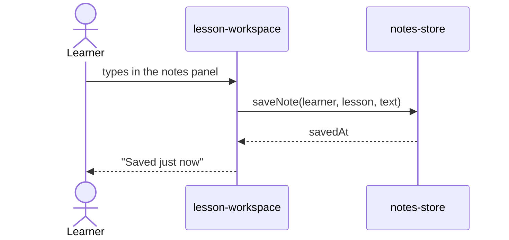
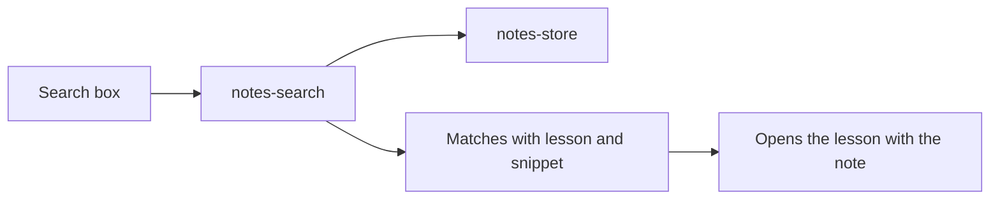

## Journey: writing a note during a lesson

The learner types beside the video; the note saves itself.

- **Stored:** one row per learner and lesson in the existing learning database.
- **Checked:** notes-store checks the learner owns the note on every read and write.
- **Leaves the system:** nothing; notes are never sent to an AI model in this phase.
- **When it fails:** the text stays in the panel and on the device, the panel says it could not save, and it tries again.

## Journey: finding a note again

## Data model

| Record | Holds | Belongs to |
|---|---|---|
| Note | text, saved at, lesson | one learner |
| Lesson | title, order | one course |
