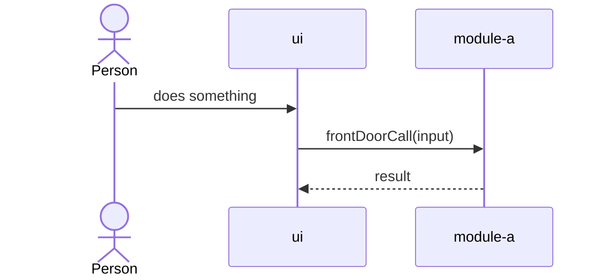

## Journey: name of a key journey

What the person is trying to do, in one sentence.

- **Stored:** where the data lives.
- **Checked:** which module enforces which rule.
- **Leaves the system:** anything sent outside (models, exports, emails), and what is removed first.
- **When it fails:** what the person sees.

## Data model

The main records and how they relate.
